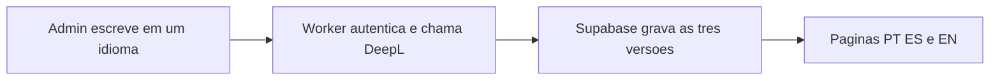

# Blog em três idiomas com Supabase

## Qual stack usar

**Supabase.** Neon com Clerk não cobre o que este blog precisa.

O site é institucional, estático, em Astro 7, e sobe na Cloudflare Workers a partir de [`wrangler.jsonc`](wrangler.jsonc). Quem vai escrever são poucas pessoas da igreja, não um cadastro aberto de membros. Para isso o blog precisa de três coisas no mesmo lugar: banco, login de quem edita e espaço para imagens.

- O **Neon** é só Postgres. Não tem login nem armazenamento de arquivos.
- O **Clerk** resolve login de produto (contas, redes sociais, organizações). Aqui isso é peso e um segundo serviço, sem guardar as fotos do post.
- Com Neon e Clerk ainda faltaria um terceiro serviço (por exemplo R2) para as imagens.

O Supabase junta os três: Postgres, Auth (e-mail e senha, com lista de quem pode entrar) e Storage. A chave anônima pode ir ao navegador; o que protege os dados é a política do banco (RLS): qualquer pessoa lê post publicado, só admin escreve. A etapa seguinte (textos e fotos das outras páginas) entra no mesmo projeto, sem trocar de stack.

## O que fica de fora agora

Textos e imagens de Início, A Igreja, Encontros, Ações e Visite continuam em [`src/i18n/content.js`](src/i18n/content.js) e [`src/data/photos.js`](src/data/photos.js). O admin, o login e o Storage desta entrega são os mesmos que essa etapa vai usar. Nenhuma tabela de “página editável” será criada agora.

## Como o texto vira três idiomas

Quem escreve escolhe o idioma do original (português, espanhol ou inglês). Ao publicar, um endpoint no Worker chama a DeepL e grava as outras duas versões no mesmo instante. As três páginas entram no ar juntas.

A DeepL cabe melhor do que um modelo generativo: ela traduz o texto e não acrescenta doutrina, versículo ou parágrafo. O volume de uma igreja cabe no plano gratuito. A chave fica só no Worker.

Regras depois da primeira publicação:

- Corrigir uma tradução marca aquela língua como editada à mão.
- Um botão “Atualizar traduções” retraduz só as línguas que ninguém editou à mão.
- O original não é sobrescrito por uma retradução.

O endereço do post é um slug só, tirado do título original e estável nas três línguas (`/blog/culto-de-pascoa`, `/es/blog/culto-de-pascoa`, `/en/blog/culto-de-pascoa`). Slug traduzido quebraria o link cada vez que a tradução mudasse.

## Modelo no Supabase

- `admins`: e-mail de quem pode entrar no painel.
- `posts`: slug único, status (`draft` ou `published`), idioma de origem, capa, data de publicação.
- `post_translations`: uma linha por idioma, com título, resumo, corpo em Markdown, título e descrição de SEO, se é o original e se foi editado à mão.
- Bucket público `blog` para a capa e as imagens do texto. Escrita só para admin.

Leitura pública só de post `published` que já tenha as três traduções. Rascunho fica invisível no site.

## O que muda no site

As páginas institucionais continuam pré-renderizadas. O blog é sob demanda, para um post novo aparecer sem outro deploy. Isso pede o adapter [`@astrojs/cloudflare`](https://docs.astro.build/en/guides/integrations-guide/cloudflare/) e `prerender = false` só nas rotas do blog, do admin, do sitemap e da tradução. O nome do Worker, o domínio e a observabilidade de [`wrangler.jsonc`](wrangler.jsonc) permanecem.

Rotas novas, no mesmo padrão de idioma de [`src/i18n/routes.js`](src/i18n/routes.js):

- `/blog`, `/es/blog`, `/en/blog`
- `/blog/[slug]`, `/es/blog/[slug]`, `/en/blog/[slug]`
- `/admin` (painel único, fora do menu, com `noindex`)

O item “Blog” entra no menu pelos textos de [`src/i18n/content.js`](src/i18n/content.js). [`src/layouts/BaseLayout.astro`](src/layouts/BaseLayout.astro) e [`src/components/Header.astro`](src/components/Header.astro) passam a aceitar título, descrição e links de idioma vindos do post, porque hoje os dois assumem uma página fixa de `content.js`. O artigo leva canonical, hreflang e JSON-LD de `Article`. [`src/pages/sitemap.xml.js`](src/pages/sitemap.xml.js) passa a listar os posts publicados junto com as 15 páginas atuais.

O visual reutiliza cabeçalho, rodapé e os estilos já existentes. O corpo é Markdown, sem HTML cru.

O painel, em português: entrar, listar, escrever, escolher o idioma, enviar imagens, salvar rascunho, publicar e corrigir cada língua. O navegador fala com o Supabase usando a sessão do admin. Só o endpoint de tradução roda no Worker, e ele recusa quem não estiver na tabela `admins`.

Secrets novos, no mesmo esquema do deploy em [`.github/workflows/deploy.yml`](.github/workflows/deploy.yml): URL e chave anônima do Supabase, e a chave da DeepL. Nada disso entra no Git.
